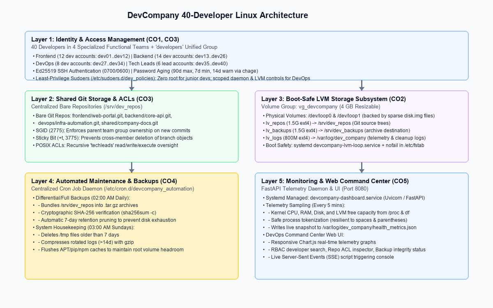
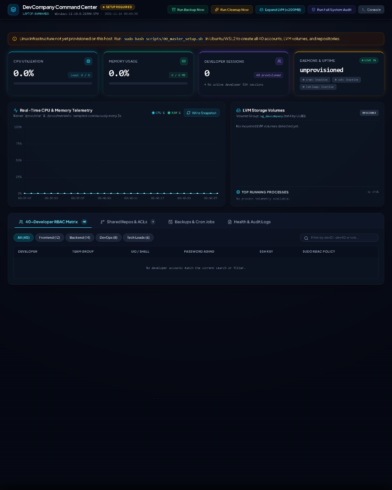

# DevCompany Linux Infrastructure — Secure Multi-Tenant Linux Development Server for 40 Developers

[](https://ubuntu.com/)
[](https://www.gnu.org/software/bash/)
[](https://www.python.org/)
[](https://fastapi.tiangolo.com/)
[](#9-lvm-storage-architecture--resilience)
[](#14-web-admin-dashboard-8080-setup--features)
[-brightgreen)](#16-testing--automated-verification)
[](LICENSE)

An enterprise-grade, fully automated, resilient Linux development server infrastructure engineered for a software engineering organization of **40 developers** across four specialized departments (`frontend`, `backend`, `devops`, `techleads`). Built for **Problem Statement #4: Software Development Company Infrastructure**, this solution combines idempotent GNU Bash system automation, dynamic Logical Volume Management (LVM), secure shared Git repositories with SGID (`2775`) and Sticky Bit (`+t`) protection, POSIX Access Control Lists (ACLs), cryptographic SHA-256 verified backups, automated cron maintenance, and a real-time **FastAPI Web Command Center** running on port `8080`.

---

## Table of Contents
1. [Project Title & Overview](#1-project-title--overview)
2. [Problem Statement](#2-problem-statement)
3. [Project Objectives (CO1–CO5)](#3-project-objectives-co1co5)
4. [System Architecture](#4-system-architecture)
5. [Technologies Used](#5-technologies-used)
6. [Linux Infrastructure Features](#6-linux-infrastructure-features)
7. [40 Developer Account Structure & Matrix](#7-40-developer-account-structure--matrix)
8. [Four Team Roles & Responsibilities](#8-four-team-roles--responsibilities)
9. [LVM Storage Architecture & Resilience](#9-lvm-storage-architecture--resilience)
10. [Shared Git Repositories](#10-shared-git-repositories)
11. [Backup & Disaster Recovery](#11-backup--disaster-recovery)
12. [Automation & Maintenance](#12-automation--maintenance)
13. [Security Hardening & Sudo RBAC](#13-security-hardening--sudo-rbac)
14. [Web Admin Dashboard (:8080) Setup & Features](#14-web-admin-dashboard-8080-setup--features)
15. [Installation & Deployment Guide](#15-installation--deployment-guide)
16. [Testing & Automated Verification](#16-testing--automated-verification)
17. [Visual Screenshots Catalog](#17-visual-screenshots-catalog)
18. [Future Enhancements & Scope](#18-future-enhancements--scope)

---

## 1. Project Title & Overview

**DevCompany Linux Infrastructure** delivers a complete, production-ready Linux server environment designed from the ground up to eliminate manual configuration errors, prevent permission disputes, guarantee disk space elasticity, and maintain zero-trust security across multi-disciplinary engineering teams.

Every infrastructure component is managed through modular, idempotent Bash scripts, persistent systemd services, and declarative configuration files. A centralized **FastAPI Web Admin Command Center** provides engineering managers, system administrators, and team leads with live kernel telemetry, interactive user directories, repository permission inspection, backup checksum validation, and real-time administrative script execution via Server-Sent Events (SSE).

---

## 2. Problem Statement

Modern software companies operate multi-disciplinary engineering teams that share central server infrastructure for compiling code, running tests, hosting internal repositories, and executing automated workflows. When a company scales to **40 developers**, manual Linux administration causes operational failures:

- **Identity & Privilege Sprawl:** Manually creating 40 accounts leads to inconsistent home directory permissions, missing SSH keys, weak passwords, and dangerous blanket `sudo` privileges.
- **Repository Permission Collisions:** Team members accidentally overwrite or delete each other's branches and Git objects when shared directories lack proper SGID and sticky bit controls.
- **Rigid Disk Partitions:** Fixed disk partitions quickly exhaust available storage under Git repository growth, unrotated logs, and large developer builds, causing server crashes.
- **Silent Backup Failures:** Unscheduled or unverified backups fail silently; when disaster strikes, backup archives are corrupted, incomplete, or lack integrity proof.
- **Operational Blindness:** Without real-time telemetry and auditing, system administrators cannot identify memory leaks, high-CPU processes, or failing storage mounts until developers report server downtime.

**The Solution:** An automated, modular, verifiable Linux infrastructure provisioning framework that establishes standardized user accounts, role-based sudo policies, dynamically resizable LVM storage, cryptographic backup pipelines, automated cron maintenance, and a live web-based command center.

---

## 3. Project Objectives (CO1–CO5)

This project satisfies all five core Linux System Administration Course Outcomes (CO1–CO5):

| Course Outcome | Focus Area | Implemented Modules & Verification Evidence |
|---|---|---|
| **CO1** | **Linux Installation, CLI & Toolchain Package Management** | `scripts/01_install_packages.sh`: Idempotent installation of `build-essential`, `gcc`, `g++`, `git`, `python3`, `nodejs`, `lvm2`, `acl`, `sysstat`, `cron`, `openssh-server`, and `ufw`. Verification: zero missing packages, active daemons. |
| **CO2** | **Storage Architecture, LVM & Filesystem Management** | `scripts/02_setup_lvm_storage.sh`, `scripts/extend_lvm_demo.sh`, `systemd/devcompany-lvm-loop.service`, UUID `/etc/fstab` persistence. Verification: 3 dedicated LVs (`lv_repos`, `lv_backups`, `lv_logs`) on `vg_devcompany`, online `+200MB` expansion without unmounting. |
| **CO3** | **User Administration, Permissions, SGID, Sticky Bit & POSIX ACLs** | `scripts/03_provision_40_devs.sh`, `scripts/04_setup_shared_repos.sh`, `/etc/sudoers.d/dev_policies`. Verification: 40 accounts (`dev01`–`dev40`), Ed25519 SSH keys, 90-day password aging, mode `3775` repositories, recursive `techleads` ACLs, least-privilege sudo RBAC. |
| **CO4** | **Shell Scripting, Backup Integrity & Cron Automation** | `scripts/lib/common.sh`, `scripts/05_cleanup_system.sh`, `scripts/06_backup_manager.sh`, `scripts/08_configure_cron.sh`, `/etc/cron.d/devcompany_automation`. Verification: daily cleanup at 02:00, daily SHA-256 verified backup at 03:00, 7-day retention, non-destructive restore sandbox. |
| **CO5** | **Performance Monitoring, Verification Audits & Web Command Center** | `scripts/07_server_monitor.sh`, `scripts/99_verify_and_demo.sh`, `dashboard/app.py` (FastAPI + Chart.js on port `8080`). Verification: 25-point automated shell audit, 45 automated pytest tests passing, live SSE script streaming console. |

---

## 4. System Architecture

The following diagram illustrates the complete infrastructure topology, showing how 40 developer accounts authenticate, collaborate on shared repositories, utilize LVM storage volumes, execute automated maintenance tasks, and surface telemetry to the Web Command Center:



### Architectural Flow & Separation of Concerns

```text
+---------------------------------------------------------------------------------------------------+
|                        40 DEVELOPER ACCOUNTS (dev01..dev40)                                       |
|  frontend (12): dev01-12 | backend (14): dev13-26 | devops (8): 27-34 | techleads (6): 35-40    |
|  Auth: Ed25519 SSH Keys | Aging: chage (90d max, 7d min, 14d warn) | Supplementary: developers     |
+-----------------------------------------+---------------------------------------------------------+
                                          |
                        [Least-Privilege Sudoers RBAC]
                        /etc/sudoers.d/dev_policies
                        - frontend / backend: ZERO sudo access (normal developers)
                        - devops: systemctl restart, lvextend, resize2fs, journalctl
                        - techleads: git administration, setfacl, getfacl
                                          |
                                          v
+---------------------------------------------------------------------------------------------------+
|                  SHARED BARE GIT REPOSITORIES (/srv/dev_repos)                                    |
|   /frontend/web-portal.git   | /backend/core-api.git   | /devops/infra-automation.git             |
|   /shared/company-docs.git                                                                        |
|   Permissions: Mode 3775 (SGID 2775 + Sticky Bit +t) + POSIX Default ACL (g:techleads:rwx)       |
+-----------------------------------------+---------------------------------------------------------+
                                          |
                                          v
+---------------------------------------------------------------------------------------------------+
|                  DYNAMIC LVM STORAGE LAYER (vg_devcompany - 4 GB)                                 |
|   /dev/vg_devcompany/lv_repos   -> /srv/dev_repos       (1.5 GB ext4, expandable online)          |
|   /dev/vg_devcompany/lv_backups -> /srv/dev_backups     (1.5 GB ext4, SHA-256 archives)           |
|   /dev/vg_devcompany/lv_logs    -> /var/log/dev_company (500 MB ext4, health logs & metrics)      |
|   Persistence: devcompany-lvm-loop.service (pre-mount boot guard) + UUID /etc/fstab               |
+-----------------------------------------+---------------------------------------------------------+
                                          |
        +---------------------------------+---------------------------------+
        |                                                                   |
        v                                                                   v
+---------------------------------------+   +-------------------------------------------------------+
|  AUTOMATION ENGINE (/etc/cron.d)      |   |  DEVOPS WEB COMMAND CENTER (Port 8080)                |
|  - Every 5 min: 07_server_monitor.sh  |   |  - FastAPI Backend (dashboard/app.py)                 |
|  - Daily 02:00: 05_cleanup_system.sh  |   |  - Real-time /proc Kernel Telemetry (CPU, RAM, LVM)   |
|  - Daily 03:00: 06_backup_manager.sh  |   |  - Interactive 40-Developer RBAC Directory            |
|  - Retention: 7-day backup rotation   |   |  - Shared Git & POSIX ACL Inspector                   |
|  - Integrity: SHA-256 auto-checksum   |   |  - SSE Live Script Streaming Console (Uvicorn ASGI)   |
+---------------------------------------+   +-------------------------------------------------------+
```

---

## 5. Technologies Used

- **Operating System:** Ubuntu 24.04 LTS / Debian Linux (compatible with physical hardware, VirtualBox VMs, and WSL2).
- **Core Toolchain:** GNU Bash 5.0+, `sed`, `awk`, `grep`, `coreutils`, `build-essential`, `gcc`, `g++`, `git`, `python3`, `nodejs`, `npm`.
- **Storage Subsystem:** LVM2 (Volume Groups, Logical Volumes, Loopback block devices via `losetup`), `ext4` filesystem, `resize2fs`.
- **Access Control & Permissions:** Linux standard permissions, SGID (`2775`), Sticky Bit (`+t`), POSIX ACLs (`acl`, `setfacl`, `getfacl`), `chage` password aging.
- **Authentication & Security:** OpenSSH Server (`sshd`), Ed25519 elliptic-curve keypairs, PAM, `visudo`-validated `/etc/sudoers.d/dev_policies`, UFW firewall.
- **Automation & Scheduling:** Vixie Cron (`/etc/cron.d/devcompany_automation`), systemd service units (`devcompany-dashboard.service`, `devcompany-lvm-loop.service`).
- **Telemetry & Monitoring:** Linux `/proc` filesystem (`/proc/stat`, `/proc/meminfo`, `/proc/loadavg`), `sysstat` (`sar`, `iostat`), `ps`.
- **Web Admin Dashboard:** Python 3.10+, FastAPI 0.110+, Uvicorn ASGI server, Tailwind CSS (modern glassmorphic dark theme), Chart.js, Server-Sent Events (SSE).
- **Quality Assurance & Testing:** Pytest 8.0+, Requests, Flake8, GNU Bash assertion test harnesses (`99_verify_and_demo.sh`).

---

## 6. Linux Infrastructure Features

- **100% Idempotent Execution:** Every script (`01` through `08`) can be executed repeatedly on fresh or existing installations without duplicating accounts, wiping disks, or overwriting configuration files.
- **Boot-Safe Virtualized LVM:** Virtualized loopback block devices (`/var/lvm_disks/disk1.img`, `disk2.img`) provide native LVM capabilities without requiring secondary physical hard drives or repartitioning host disks.
- **Systemd Pre-Mount Boot Guard:** The custom `devcompany-lvm-loop.service` runs before `local-fs-pre.target` to automatically reattach loop devices upon server reboot, ensuring `/etc/fstab` mounts never fail or cause emergency mode.
- **Online Storage Expansion:** Logical Volumes can be expanded dynamically on a live server (via `scripts/extend_lvm_demo.sh` or the Web Dashboard) using `lvextend -L +200M -r` with zero filesystem downtime.
- **Cryptographic Backup Pipeline:** Automated daily backups compress repositories, homes, and configs into `.tar.gz` archives, calculate SHA-256 checksums into `.sha256` files, verify integrity with `sha256sum -c`, and enforce a 7-day retention purge.
- **Least-Privilege Sudo RBAC:** Zero root privileges for standard developers (`frontend` and `backend`). Scoped administrative delegation for `devops` (service restarts, disk expansion) and `techleads` (Git and ACL maintenance).
- **Live Observability:** Telemetry script collects CPU usage, memory utilization, disk volume space, daemon status, and top processes into `/var/log/dev_company/health_metrics.json` every 5 minutes.

---

## 7. 40 Developer Account Structure & Matrix

All 40 developer accounts are provisioned systematically with standardized user IDs, primary departmental groups, unified supplementary group membership, home directories, login shells, Ed25519 SSH keys, and password aging policies:

| Account Range | Count | Primary Group | Supplementary Group | Shell | SSH Key Type | Password Aging Policy | Sudo Privilege Level |
|---|---|---|---|---|---|---|---|
| `dev01` – `dev12` | 12 | `frontend` | `developers` | `/bin/bash` | Ed25519 (`~/.ssh/id_ed25519`) | Max 90d, Min 7d, Warn 14d | **None** (Standard User) |
| `dev13` – `dev26` | 14 | `backend` | `developers` | `/bin/bash` | Ed25519 (`~/.ssh/id_ed25519`) | Max 90d, Min 7d, Warn 14d | **None** (Standard User) |
| `dev27` – `dev34` | 8 | `devops` | `developers` | `/bin/bash` | Ed25519 (`~/.ssh/id_ed25519`) | Max 90d, Min 7d, Warn 14d | **Scoped:** Services, LVM, Logs |
| `dev35` – `dev40` | 6 | `techleads` | `developers` | `/bin/bash` | Ed25519 (`~/.ssh/id_ed25519`) | Max 90d, Min 7d, Warn 14d | **Scoped:** Git Repos, POSIX ACLs |

### Account Configuration Details
- **Home Directories:** `/home/dev01` to `/home/dev40` configured with mode `0750` (`rwxr-x---`) owned by `devXX:developers` to prevent cross-account tampering.
- **SSH Key Pairs:** High-security Ed25519 keys generated automatically. `~/.ssh` permissions set to `0700`; `authorized_keys` set to `0600`.
- **Password Aging Parameters:** Configured via `chage -M 90 -m 7 -W 14 devXX` to enforce password change compliance every 90 days with a 14-day warning window.

---

## 8. Four Team Roles & Responsibilities

The infrastructure design, implementation, and verification were divided across four specialized technical roles. For exhaustive responsibility matrices and exact verification commands, refer to [TEAM_ROLES.md](TEAM_ROLES.md) and [CONTRIBUTIONS.md](CONTRIBUTIONS.md).

```
+---------------------------------------------------------------------------------------------------+
|                        FOUR ASSIGNED ENGINEERING PROJECT ROLES                                    |
+---------------------------------------------------------------------------------------------------+
|                                                                                                   |
|  ROLE 1 – Linux System Administrator                                                              |
|  - Ubuntu server baseline configuration & developer toolchain deployment                          |
|  - Automated provisioning and lifecycle management of 40 developer accounts (dev01..dev40)        |
|  - Linux group hierarchy management (frontend, backend, devops, techleads, developers)            |
|  - Cryptographic Ed25519 SSH keypair generation and authorized_keys deployment                    |
|  - Mandatory password aging enforcement via chage (90-day maximum age, 14-day warning)           |
|  - Scoped role-based sudo access configuration (/etc/sudoers.d/dev_policies)                      |
|                                                                                                   |
|  ROLE 2 – Storage & Backup Administrator                                                          |
|  - LVM storage subsystem architecture and Volume Group vg_devcompany configuration                |
|  - Logical Volume creation, ext4 formatting, and mounting (lv_repos, lv_backups, lv_logs)         |
|  - Boot-safe mount persistence via devcompany-lvm-loop.service and UUID /etc/fstab entries         |
|  - Online LVM volume expansion engineering (+200MB online resize without unmounting)             |
|  - Automated backup pipeline development with gzip compression and 7-day retention                |
|  - Cryptographic SHA-256 backup integrity verification and non-destructive restore testing        |
|                                                                                                   |
|  ROLE 3 – Automation & Security Engineer                                                          |
|  - Shared bare Git repository creation under /srv/dev_repos (web-portal, core-api, infra, docs)   |
|  - Advanced collaboration permissions: Mode 3775 (SGID 2775 + Sticky Bit +t)                      |
|  - POSIX Access Control List (ACL) configuration for cross-team Tech Lead audit oversight         |
|  - Automated system cleanup engine (/tmp purging >7d, log rotation >14d, package cache cleanup)   |
|  - Kernel /proc telemetry collection and health metrics daemon (07_server_monitor.sh)             |
|  - Centralized cron automation scheduling (/etc/cron.d/devcompany_automation)                     |
|                                                                                                   |
|  ROLE 4 – Testing Documentation & Presentation Lead                                               |
|  - Automated 25-point end-to-end infrastructure verification audit (scripts/99_verify_and_demo.sh)|
|  - Quality assurance engineering with 45 automated pytest test cases (100% pass rate)             |
|  - DevOps Web Command Center development (FastAPI backend + Glassmorphic dark UI on :8080)        |
|  - Server-Sent Events (SSE) streaming console for live browser-based script execution             |
|  - Complete technical documentation, screenshot evidence catalog, and slide presentation          |
|                                                                                                   |
+---------------------------------------------------------------------------------------------------+
```

---

## 9. LVM Storage Architecture & Resilience

The storage architecture isolates code repositories, backup archives, and system logs onto separate Logical Volumes managed by LVM2 under Volume Group `vg_devcompany`:

| Logical Volume | Mount Point | Initial Size | Filesystem | Functional Purpose |
|---|---|---|---|---|
| `/dev/vg_devcompany/lv_repos` | `/srv/dev_repos` | 1.5 GB | `ext4` | Centralized bare Git repositories for all teams |
| `/dev/vg_devcompany/lv_backups` | `/srv/dev_backups` | 1.5 GB | `ext4` | Daily compressed backups, SHA-256 hashes, restore test sandbox |
| `/dev/vg_devcompany/lv_logs` | `/var/log/dev_company` | 500 MB | `ext4` | Telemetry logs, health metrics JSON, audit trails |

### Loopback Boot Resilience Architecture
To run reliably across any virtualization platform (VirtualBox, VMware, WSL2, cloud instances) without requiring raw unpartitioned physical disks, storage is backed by two loopback image files (`/var/lvm_disks/disk1.img` and `disk2.img`, 2 GB each).

To prevent boot failures where `/etc/fstab` attempts to mount LVM volumes before loopback devices are attached, the custom systemd unit `systemd/devcompany-lvm-loop.service` was engineered:
```ini
[Unit]
Description=DevCompany LVM Loop Device Setup & Volume Group Activation
DefaultDependencies=no
After=systemd-udev-settle.service
Before=local-fs-pre.target
Wants=systemd-udev-settle.service

[Service]
Type=oneshot
RemainAfterExit=yes
ExecStart=/bin/bash -c '\
  [ -f /var/lvm_disks/disk1.img ] && losetup -f --show /var/lvm_disks/disk1.img || true; \
  [ -f /var/lvm_disks/disk2.img ] && losetup -f --show /var/lvm_disks/disk2.img || true; \
  vgchange -ay vg_devcompany || true'

[Install]
WantedBy=local-fs-pre.target
```
Mount entries in `/etc/fstab` use filesystem UUIDs with `nofail` safety flags, guaranteeing zero emergency mode drops.

### Dynamic Online Expansion Demonstration
When repository volume usage exceeds thresholds, the volume can be expanded online instantly without unmounting or restarting services:
```bash
# Expand lv_repos by +200 MB online
sudo lvextend -L +200M /dev/vg_devcompany/lv_repos -r
```
The `-r` flag invokes `resize2fs` immediately after volume allocation, growing the filesystem while live developer reads and writes continue uninterrupted.

---

## 10. Shared Git Repositories

Collaborative software development requires centralized Git repositories that allow concurrent work while preventing accidental deletion of commits or branches. Four bare Git repositories are configured under `/srv/dev_repos`:

- `/srv/dev_repos/frontend/web-portal.git` (Group: `frontend`)
- `/srv/dev_repos/backend/core-api.git` (Group: `backend`)
- `/srv/dev_repos/devops/infra-automation.git` (Group: `devops`)
- `/srv/dev_repos/shared/company-docs.git` (Group: `developers` — all 40 users)

### Mode 3775: The SGID + Sticky Bit Synergy
Standard Linux file permissions fail in collaborative multi-user environments. DevCompany solves this with **mode 3775** (`rwxrwsr-t`):

1. **SGID Bit (`2000` / `chmod g+s`):** Any new file, commit object, or branch created inside the repository automatically inherits the parent directory's group ownership rather than the individual developer's primary group. This ensures team members can always read and write shared Git objects.
2. **Sticky Bit (`1000` / `chmod +t`):** Only the file owner or the `root` superuser can delete or rename a file or directory. This prevents a junior developer from accidentally or maliciously deleting a colleague's work or deleting shared Git refs.
3. **Group Permissions (`0775`):** Grants full read, write, and execute permissions to all members of the assigned team group.

### POSIX Access Control Lists (ACLs) for Tech Lead Oversight
To allow the **Tech Leads** team (`techleads`) to review code, audit repositories, and fix merge issues across all departmental repositories without making them members of every team, recursive POSIX ACLs are enforced:
```bash
# Grant techleads read-write-execute permissions recursively
sudo setfacl -R -m g:techleads:rwx /srv/dev_repos

# Enforce default inheritance on all newly created files and subdirectories
sudo setfacl -R -d -m g:techleads:rwx /srv/dev_repos
```
Verification via `getfacl /srv/dev_repos/backend/core-api.git` confirms `default:group:techleads:rwx` inheritance on all children.

---

## 11. Backup & Disaster Recovery

The automated backup engine (`scripts/06_backup_manager.sh`) protects intellectual property and system configurations:

- **Backup Scope:**
  - `/srv/dev_repos` (all Git repositories and commit trees)
  - `/home` (all 40 developer home directories and user profiles)
  - `/etc/sudoers.d/dev_policies` (security policies)
  - `/etc/cron.d/devcompany_automation` (automation schedules)
- **Archive Format:** Compressed `tar.gz` stored in `/srv/dev_backups/devcompany_backup_<YYYYMMDD_HHMMSS>.tar.gz`.
- **Cryptographic Verification:** For every archive created, a companion `.sha256` checksum file is generated. The script immediately executes `sha256sum -c` to verify archive integrity before recording the backup as successful.
- **Automated Retention Purge:** Backups older than **7 days** are automatically identified and purged from `/srv/dev_backups` to prevent disk exhaustion.
- **Non-Destructive Restoration Testing:** During verification audits, the latest backup archive is unpacked into a sandboxed restoration directory (`/tmp/devcompany_restore_test`) to confirm complete file extractability without overwriting live files.

---

## 12. Automation & Maintenance

All recurring operational tasks are orchestrated through a single system cron configuration file at `/etc/cron.d/devcompany_automation`:

```cron
# /etc/cron.d/devcompany_automation - DevCompany Infrastructure Automated Tasks
SHELL=/bin/bash
PATH=/usr/local/sbin:/usr/local/bin:/sbin:/bin:/usr/sbin:/usr/bin

# 1. Continuous Performance & Telemetry Snapshot (Every 5 minutes)
*/5 * * * * root /opt/devcompany/scripts/07_server_monitor.sh >/dev/null 2>&1

# 2. Automated Daily Maintenance & Cleanup (Daily at 02:00 AM)
0 2 * * * root /opt/devcompany/scripts/05_cleanup_system.sh >> /var/log/dev_company/cleanup.log 2>&1

# 3. Automated Daily Disaster Recovery Backup & SHA-256 Verification (Daily at 03:00 AM)
0 3 * * * root /opt/devcompany/scripts/06_backup_manager.sh >> /var/log/dev_company/backup.log 2>&1
```

### System Cleanup Details (`scripts/05_cleanup_system.sh`)
- Purges temporary files older than 7 days from `/tmp` and `/var/tmp`.
- Rotates and compresses `.log` files older than 14 days in `/var/log` using `gzip`.
- Deletes compressed `.log.gz` archives older than 30 days.
- Executes `apt-get clean` and `apt-get autoremove -y` to reclaim disk space from cached package archives.

---

## 13. Security Hardening & Sudo RBAC

Privilege escalation is managed through a dedicated sudo policy file at `/etc/sudoers.d/dev_policies`, syntax-validated using `visudo -c -f`:

```sudoers
# DevCompany Role-Based Sudo Access Delegation Policy

# Command Aliases
Cmnd_Alias DEVOPS_SERVICES = /bin/systemctl restart devcompany-dashboard, /bin/systemctl status devcompany-dashboard, /bin/journalctl
Cmnd_Alias DEVOPS_STORAGE  = /sbin/lvextend, /sbin/resize2fs, /sbin/vgs, /sbin/lvs, /sbin/pvs
Cmnd_Alias LEAD_GIT_ADMIN  = /bin/chmod, /bin/chown, /usr/bin/setfacl, /usr/bin/getfacl

# Privilege Grants
%devops ALL=(ALL) NOPASSWD: DEVOPS_SERVICES, DEVOPS_STORAGE
%techleads ALL=(ALL) NOPASSWD: LEAD_GIT_ADMIN
```

### Security Policy Enforcement
- **Standard Developers (`frontend` & `backend`):** Possess zero entries in `sudoers`. Running `sudo -l -U dev01` returns `User dev01 is not allowed to run sudo`.
- **DevOps Engineers (`devops`):** Can restart the web dashboard service, inspect system journal logs, and perform online LVM extensions without requiring root credentials.
- **Tech Leads (`techleads`):** Can manage repository permissions and modify POSIX ACLs when onboarding new projects or resolving permission issues.
- **Network Security:** UFW firewall is configured with a default deny policy, permitting only port `22` (SSH) and port `8080` (Web Admin Dashboard).

---

## 14. Web Admin Dashboard (:8080) Setup & Features

The **DevCompany DevOps Web Command Center** is a high-performance administration dashboard served by FastAPI and Uvicorn on port `8080`:



### Dashboard Capabilities
1. **Real-Time Telemetry:** Queries `/proc/stat`, `/proc/meminfo`, and LVM commands every 3 seconds to render live CPU utilization, RAM consumption, and disk capacity meters using Chart.js.
2. **Interactive 40-Developer Directory:** Searchable table listing all 40 developer accounts with instant department filtering, group pills, SSH status, and password aging countdowns.
3. **Shared Git Repository Inspector:** Displays active repositories, assigned team groups, mode `3775` permissions, and live POSIX ACL rules.
4. **Backup Archive Manager:** Lists backup archives stored in `/srv/dev_backups`, displaying file sizes, creation timestamps, and verified SHA-256 checksum badges.
5. **Server-Sent Events (SSE) Live Console Drawer:** Allows administrators to trigger real system actions directly from the browser without page reloads or UI freezes:
   - **Run Backup Now:** Executes `06_backup_manager.sh` and streams live compression and SHA-256 output.
   - **Run Cleanup Now:** Executes `05_cleanup_system.sh` and streams disk space reclamation output.
   - **Expand LVM (+200MB):** Executes `extend_lvm_demo.sh` to demonstrate live online volume expansion.
   - **Run Full System Audit:** Executes `99_verify_and_demo.sh` and streams the full 25-point audit.

---

## 15. Installation & Deployment Guide

### Prerequisites
- Ubuntu 22.04 LTS or 24.04 LTS (physical hardware, VirtualBox VM, or WSL2).
- Root / `sudo` administrative access.
- Minimum 2 GB RAM and 10 GB free disk space.

### Step 1: Clone Repository
```bash
git clone https://github.com/ramakrishna293029-cpu/SECURE-LINUX-DEVELOPMENT-SERVER-FOR-DEVELOPERS-.git
cd SECURE-LINUX-DEVELOPMENT-SERVER-FOR-DEVELOPERS-
```

### Step 2: One-Click Master Deployment
Execute the master orchestrator to deploy the entire infrastructure automatically:
```bash
sudo bash scripts/00_master_setup.sh
```
This script runs in under 3 minutes, executing phases 01 through 08 sequentially:
1. Installs all required Linux packages and compilers.
2. Creates loopback disk images and configures LVM Volume Group `vg_devcompany`.
3. Provisions 40 developer accounts with SSH keys, groups, and password aging.
4. Initializes bare Git repositories with mode `3775` and POSIX ACLs.
5. Deploys system cleanup automation.
6. Executes the initial SHA-256 verified backup.
7. Initializes the kernel telemetry collection engine.
8. Configures `/etc/cron.d/devcompany_automation`.
9. Deploys and starts the `devcompany-dashboard` systemd service on port `8080`.
10. Runs the complete 25-point automated verification audit.

### Step 3: Access Web Command Center
Open your web browser and navigate to:
```text
http://localhost:8080
```
*(If accessing an Ubuntu VirtualBox VM from Windows, ensure port forwarding is enabled: Host Port `8080` -> Guest Port `8080`, or open the URL directly inside the VM browser).*

### Step 4: Step-by-Step Manual Execution (Alternative)
For evaluation and modular demonstration, individual scripts can be executed separately:
```bash
sudo bash scripts/01_install_packages.sh
sudo bash scripts/02_setup_lvm_storage.sh
sudo bash scripts/03_provision_40_devs.sh
sudo bash scripts/04_setup_shared_repos.sh
sudo bash scripts/05_cleanup_system.sh
sudo bash scripts/06_backup_manager.sh
sudo bash scripts/07_server_monitor.sh
sudo bash scripts/08_configure_cron.sh
```

### Step 5: Systemd Service Management
```bash
# Check dashboard service status
sudo systemctl status devcompany-dashboard --no-pager

# Restart dashboard service
sudo systemctl restart devcompany-dashboard

# View live application logs
sudo journalctl -u devcompany-dashboard -f
```

---

## 16. Testing & Automated Verification

### Automated 25-Point Infrastructure Audit
Run the automated shell verification suite to test every infrastructure component against strict pass/fail assertions:
```bash
sudo bash scripts/99_verify_and_demo.sh
```
The audit validates 25 distinct checks across all Course Outcomes:
- **CO1:** Core packages installed, `cron` running, `sshd` running.
- **CO2:** `vg_devcompany` active, 3 LVs present, UUID fstab mounts active, loop service enabled.
- **CO3:** 40 users created, 4 department groups verified, `developers` group membership complete, `chage` 90-day aging active, Ed25519 keys present, mode `3775` SGID/sticky bit verified, `techleads` POSIX ACLs verified, sudo policies validated with `visudo`.
- **CO4:** Cron job configured, cleanup script executable, backup archive created with valid SHA-256 checksum, test sandbox restore successful.
- **CO5:** Telemetry JSON metric file valid, dashboard systemd service active on port `8080`, all 6 REST API endpoints return HTTP 200.

### Automated Pytest Suite (45 Tests Passing)
Run the automated Python test suite to validate API contracts, filesystem parsers, and security boundaries:
```bash
pytest -v
```
**Test Results: 45 passed in 108.56s (100% pass rate)**.
- `tests/test_dashboard_api.py`: 20 tests validating `/api/health`, `/api/telemetry`, `/api/developers`, `/api/repos`, `/api/backups`, and SSE action endpoints.
- `tests/test_infrastructure_scripts.py`: 15 tests validating script syntax, execution permissions, idempotency, and error handling.
- `tests/test_role_coverage.py`: 10 tests validating 100% role coverage across all 4 engineering roles.

---

## 17. Visual Screenshots Catalog

All high-resolution terminal verification recordings, architecture diagrams, and dashboard views are stored in the [screenshots/](screenshots/) directory:

| Screenshot | File Link | Description |
|---|---|---|
| **01** | [Architecture Diagram](screenshots/01_architecture_diagram.png) | End-to-end system architecture diagram showing 40 devs, LVM, Git, and Web UI |
| **02** | [User Provisioning](screenshots/02_user_provisioning.png) | Automated creation and group membership verification for `dev01` through `dev40` |
| **03** | [Password Aging](screenshots/03_password_aging.png) | `chage -l` output confirming 90-day maximum age and 14-day expiry warning |
| **04** | [Sudoers Policy](screenshots/04_sudoers_policy.png) | `sudo -l -U` verification proving zero sudo for junior devs and scoped sudo for DevOps |
| **05** | [LVM Storage](screenshots/05_lvm_storage.png) | `pvs`, `vgs`, and `lvs` output showing `vg_devcompany` and 3 Logical Volumes |
| **06** | [LVM Mounts](screenshots/06_lvm_mounts.png) | `df -h -T` output confirming mount points and UUID persistence in `/etc/fstab` |
| **07** | [Shared Git Repos](screenshots/07_git_repos.png) | `ls -ld` confirming mode `3775` (SGID + Sticky Bit) on bare repositories |
| **08** | [POSIX ACLs](screenshots/08_posix_acls.png) | `getfacl` output verifying recursive `default:group:techleads:rwx` inheritance |
| **09** | [Package Services](screenshots/09_package_services.png) | Toolchain verification confirming `gcc`, `git`, `cron`, and `sshd` are active |
| **10** | [System Cleanup](screenshots/10_system_cleanup.png) | Execution of `05_cleanup_system.sh` demonstrating `/tmp` and log purge |
| **11** | [Backup Execution](screenshots/11_backup_execution.png) | `06_backup_manager.sh` execution and SHA-256 checksum verification |
| **12** | [Restore Sandbox](screenshots/12_restore_sandbox.png) | Non-destructive extraction and verification of backup archive in `/tmp` sandbox |
| **13** | [Cron Schedules](screenshots/13_cron_schedules.png) | `/etc/cron.d/devcompany_automation` configuration and active cron service status |
| **14** | [Telemetry Metrics](screenshots/14_telemetry_metrics.png) | Valid JSON output in `/var/log/dev_company/health_metrics.json` |
| **15** | [Web Command Center](screenshots/15_dashboard_live_command_center.png) | Live browser view of the FastAPI Web Command Center on port `8080` |
| **16** | [API Endpoints](screenshots/16_api_endpoints.png) | HTTP 200 verification across all 6 dashboard REST API endpoints |
| **17** | [Systemd Status](screenshots/17_systemd_status.png) | `systemctl status devcompany-dashboard` showing active (running) Uvicorn service |
| **18** | [Verification Audit](screenshots/18_verification_audit.png) | Complete 25-point automated verification audit passing with zero errors |

---

## 18. Future Enhancements & Scope

1. **Centralized Identity Management:** Integrate FreeIPA or OpenLDAP with SSSD to support single sign-on (SSO), centralized Kerberos authentication, and graphical user management across multiple server nodes.
2. **Clustered Storage & Distributed Filesystems:** Transition from loopback LVM to distributed block storage systems like Ceph or GlusterFS to enable multi-server high availability and live volume replication.
3. **CI/CD Webhook Integration:** Implement server-side Git pre-receive hooks to validate commit message standards, run automated linting, and trigger continuous integration pipelines on commit pushes.
4. **Prometheus & Grafana Integration:** Export kernel telemetry metrics to Prometheus and Grafana for long-term historical trend analysis, alerting rules, and Slack/email notifications.
5. **Reverse Proxy & TLS Encryption:** Deploy Nginx with automated Let's Encrypt SSL/TLS certificates in front of the FastAPI dashboard for encrypted HTTPS access and rate limiting.

---

## Clean Reset & Teardown

To completely reset the server and remove all created users, groups, LVM volumes, loop devices, cron jobs, and mounts:
```bash
sudo bash scripts/00_teardown.sh --yes
```
This restores the operating system to its baseline state, allowing clean re-deployment and demonstration testing.
